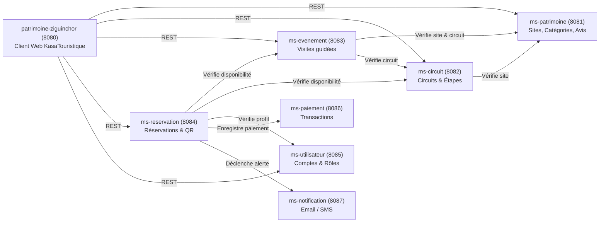

# KasaTouristique — Gestion du Patrimoine Touristique de Ziguinchor (Architecture Microservices TP1)

Application distribuée Spring Boot développée dans le cadre du cours **Développement d'Applications Orientées Services** (Licence 3 en Ingénierie Informatique — **Université Assane Seck de Ziguinchor**, Dr Lamine FATY) basée sur le **TP1 : Création des Microservices**.

Le projet transforme l'application monolithique initiale en une architecture composée de **7 microservices REST Spring Boot indépendants** (ports `8081` à `8087`) et d'un **portail web client Thymeleaf** nommé **KasaTouristique** (port `8080`), couvrant les 15 sites touristiques majeurs des trois départements de la région de Ziguinchor (*Ziguinchor, Oussouye, Bignona*).

---

## 1. Architecture et Rôle des 8 Modules

Chaque microservice respecte le principe **Database per Service** (une base H2 en mémoire dédiée par service) et expose une API REST JSON. Les services communiquent entre eux en HTTP synchrone via `RestTemplate`.

| Module | Port | Base H2 dédiée | Rôle principal | Endpoint de base |
|---|---|---|---|---|
| `patrimoine-ziguinchor` | `8080` | `patrimoinedb` | Interface Web **KasaTouristique** (Thymeleaf, Spring Security, recherche, billets QR Code, page de supervision `/microservices`) | `http://localhost:8080` |
| `ms-patrimoine` | `8081` | `patrimoinedb` | Catalogue des 15 sites patrimoniaux, catégories, photos, horaires, géolocalisation et avis visiteurs | `http://localhost:8081/api/patrimoines` |
| `ms-circuit` | `8082` | `circuitdb` | Création et gestion des circuits touristiques (étapes ordonnées, durée, distance, difficulté, disponibilité) | `http://localhost:8082/api/circuits` |
| `ms-evenement` | `8083` | `evenementdb` | Planning des visites guidées, ateliers et événements, gestion de la capacité maximale | `http://localhost:8083/api/evenements` |
| `ms-reservation` | `8084` | `reservationdb` | Cycle de vie des réservations (création, confirmation, suppression/annulation, QR code) avec orchestration inter-services | `http://localhost:8084/api/reservations` |
| `ms-utilisateur` | `8085` | `utilisateurdb` | Inscription, authentification, profils et rôles (`VISITEUR`, `CONSERVATEUR`, `OPERATEUR_TOURISTIQUE`, `ADMINISTRATEUR_COMMUNAL`, `SUPER_ADMIN`) | `http://localhost:8085/api/utilisateurs` |
| `ms-paiement` | `8086` | `paiementdb` | Enregistrement des paiements (Wave, Orange Money, carte, espèces) et remboursements | `http://localhost:8086/api/paiements` |
| `ms-notification` | `8087` | `notificationdb` | Envoi et historique des notifications Email/SMS (confirmation, annulation, rappel) | `http://localhost:8087/api/notifications` |

### Flux de communication inter-microservices



---

## 2. Explication détaillée des paramètres de configuration

### A. Paramètres Maven (`pom.xml` racine et des modules — TP1 pages 7 à 10)

Le fichier racine `pom.xml` (`packaging: pom`) regroupe les 8 modules pour permettre leur compilation globale en une seule commande. Chaque module hérite de `spring-boot-starter-parent` (`3.2.5`) avec les propriétés et dépendances suivantes :

| Paramètre / Dépendance | Valeur dans le projet | Explication |
|---|---|---|
| `<groupId>` | `com.uasz` (microservices) / `com.ziguinchor` (web) | Identifiant de l'organisation/projet Java. |
| `<artifactId>` | `ms-patrimoine`, `ms-circuit`, ..., `patrimoine-ziguinchor` | Nom unique du module Maven et de l'archive JAR générée. |
| `<version>` | `1.0.0` | Version courante du livrable applicatif. |
| `<packaging>` | `pom` (racine) / `jar` (modules par défaut) | `pom` déclare un projet agrégateur ; `jar` produit une archive exécutable autonome embarquant Tomcat. |
| `<java.version>` | `17` | Version cible du compilateur Java (compatible JDK 17 à 25). |
| `spring-boot-starter-web` | Starter Spring MVC | Fournit les contrôleurs `@RestController`, la sérialisation JSON (Jackson) et le serveur Apache Tomcat embarqué. |
| `spring-boot-starter-data-jpa` | Spring Data + Hibernate | Couche de persistance SQL générant automatiquement les requêtes CRUD via `JpaRepository` (`save()`, `findAll()`, `findById()`, `deleteById()`). |
| `spring-boot-starter-validation` | Hibernate Validator | Active la validation déclarative des champs (`@NotBlank`, `@Email`, `@Min`, etc.). |
| `com.h2database:h2` | Portée `runtime` | Base de données SQL embarquée en mémoire (~2 Mo), rapide et sans installation externe. |
| `com.mysql:mysql-connector-j` | Portée `runtime` | Pilote JDBC MySQL conservé prêt pour basculer vers une base MySQL / XAMPP. |
| `spring-boot-devtools` | Optionnel `runtime` | Accélère le développement (redémarrage rapide à chaud lors des modifications). |
| `spring-boot-starter-thymeleaf` & `spring-boot-starter-security` | Modules du portail `patrimoine-ziguinchor` | Moteur de templates HTML dynamiques côté serveur, authentification et autorisation selon les rôles (`sec:authorize`). |
| `spring-cloud-starter-netflix-eureka-client`, `spring-cloud-starter-config`, `spring-boot-starter-actuator` | Commentés dans les `pom.xml` | Dépendances mentionnées dans le TP1 et préparées en commentaire pour l'étape d'enregistrement Eureka / Config Server / monitoring Actuator. |

---

### B. Paramètres généraux du serveur (`application.yml` / `application.properties`)

| Paramètre | Valeurs | Signification et rôle |
|---|---|---|
| `server.port` | `8080` à `8087` | Numéro de port TCP sur lequel écoute le serveur Tomcat embarqué de chaque application. Attribuer un port différent par service est indispensable pour exécuter les 8 applications ensemble sur la même machine. |
| `spring.application.name` | `patrimoine-ziguinchor`, `ms-patrimoine`, `ms-circuit`, `ms-evenement`, `ms-reservation`, `ms-utilisateur`, `ms-paiement`, `ms-notification` | Nom logique identifiant l'application dans les logs Spring Boot et auprès d'un serveur de découverte (Eureka). |

---

### C. Paramètres de la base de données H2 (`spring.datasource.*` & `spring.h2.*`)

Exemple issu de `ms-patrimoine/src/main/resources/application.yml` :

```yaml
spring:
  datasource:
    url: 'jdbc:h2:mem:patrimoinedb;DB_CLOSE_DELAY=-1;DB_CLOSE_ON_EXIT=FALSE'
    driver-class-name: org.h2.Driver
    username: sa
    password: ''
  h2:
    console:
      enabled: true
```

| Paramètre | Valeur | Explication détaillée |
|---|---|---|
| `spring.datasource.url` | `jdbc:h2:mem:<nom_db>;DB_CLOSE_DELAY=-1;DB_CLOSE_ON_EXIT=FALSE` | URL de connexion JDBC vers H2 :<br>• `mem:<nom_db>` crée une **base en mémoire propre à chaque microservice** (`patrimoinedb`, `circuitdb`, `evenementdb`, `reservationdb`, `utilisateurdb`, `paiementdb`, `notificationdb`).<br>• `DB_CLOSE_DELAY=-1` maintient la base en mémoire ouverte tant que le processus JVM tourne, même quand la dernière connexion se ferme.<br>• `DB_CLOSE_ON_EXIT=FALSE` empêche H2 de fermer prématurément la base lors d'un rechargement à chaud par `spring-boot-devtools`. |
| `spring.datasource.driver-class-name` *(ou `driverClassName` en `.properties`)* | `org.h2.Driver` | Classe Java du pilote JDBC utilisé par HikariCP pour dialoguer avec H2. |
| `spring.datasource.username` | `sa` | Nom de l'utilisateur administrateur par défaut (*System Administrator*) de la base H2. |
| `spring.datasource.password` | `''` *(vide)* | Mot de passe de connexion H2 (vide par défaut en environnement local). |
| `spring.h2.console.enabled` | `true` | Active la console web SQL intégrée pour inspecter les tables et exécuter des requêtes depuis le navigateur. |
| `spring.h2.console.path` | `/h2-console` *(portail web `8080`)* | Chemin URL d'accès à la console H2 (`http://localhost:8080/h2-console`, et par défaut `/h2-console` sur les microservices `8081`–`8087`). |

---

### D. Paramètres JPA / Hibernate & Web (`spring.jpa.*`, `spring.sql.*`, `spring.thymeleaf.*`)

| Paramètre | Valeur | Explication détaillée |
|---|---|---|
| `spring.jpa.show-sql` | `true` | Affiche dans la console toutes les requêtes SQL générées par Hibernate (utile pour vérifier les insertions initiales et le fonctionnement des endpoints). |
| `spring.jpa.properties.hibernate.format_sql` | `true` *(`patrimoine-ziguinchor`)* | Met en forme et indente les requêtes SQL affichées dans les logs pour les rendre lisibles. |
| `spring.jpa.hibernate.ddl-auto` | `update` | Indique à Hibernate de créer automatiquement les tables à partir des classes annotées `@Entity` et de mettre à jour le schéma si des colonnes sont ajoutées. |
| `spring.sql.init.mode` | `never` *(`patrimoine-ziguinchor`)* | Désactive l'exécution automatique de scripts SQL statiques (`schema.sql`/`data.sql`) afin de laisser les classes `DonneesInitiales` (`CommandLineRunner`) initialiser les données en Java de manière contrôlée. |
| `spring.thymeleaf.cache` | `false` *(`patrimoine-ziguinchor`)* | Désactive le cache des templates HTML Thymeleaf pour prendre en compte les modifications d'interface sans redémarrer le serveur. |

---

### E. Paramètres Spring Cloud & Actuator (`spring.cloud.*`, `management.*` — TP1 page 12)

Conformément à la configuration du TP1 :

```yaml
spring:
  cloud:
    config:
      enabled: false
    discovery:
      enabled: false

management:
  endpoints:
    web:
      exposure:
        include: '*'
```

| Paramètre | Valeur | Explication détaillée |
|---|---|---|
| `spring.cloud.config.enabled` | `false` | Désactive la recherche d'un serveur Spring Cloud Config externe au démarrage : le microservice utilise directement son fichier local `application.yml`. |
| `spring.cloud.discovery.enabled` | `false` | Désactive l'enregistrement automatique auprès d'un serveur d'annuaire Eureka afin que le microservice fonctionne en local sans dépendance externe. |
| `management.endpoints.web.exposure.include` | `'*'` | Paramètre **Spring Boot Actuator** qui expose tous les endpoints web de supervision (`/actuator/health`, `/actuator/info`, `/actuator/metrics`, etc.) dès que `spring-boot-starter-actuator` est activé dans le `pom.xml`. |

---

### F. Paramètres de communication inter-microservices (`microservices.*.url`)

Au lieu de coder en dur les adresses des autres services dans les classes Java, chaque URL est externalisée dans `application.properties` ou `application.yml` et injectée via `@Value(...)` :

| Paramètre | Valeur par défaut | Services consommateurs | Rôle |
|---|---|---|---|
| `microservices.patrimoine.url` | `http://localhost:8081` | `patrimoine-ziguinchor`, `ms-circuit`, `ms-evenement` | Importe et synchronise les 15 sites touristiques, catégories et avis ; vérifie l'existence d'un site avant de créer un circuit ou événement. |
| `microservices.circuit.url` | `http://localhost:8082` | `patrimoine-ziguinchor`, `ms-evenement`, `ms-reservation` | Synchronise les circuits et vérifie leur disponibilité avant validation d'une réservation. |
| `microservices.evenement.url` | `http://localhost:8083` | `patrimoine-ziguinchor`, `ms-reservation` | Gère le planning des visites guidées et décrémente/libère les places disponibles lors des réservations/annulations. |
| `microservices.reservation.url` | `http://localhost:8084` | `patrimoine-ziguinchor` | Transmet les nouvelles réservations (nom, email, places, montant, code billet `ZIG-2026-XXXX`) et propage les suppressions/annulations. |
| `microservices.utilisateur.url` | `http://localhost:8085` | `patrimoine-ziguinchor`, `ms-reservation` | Synchronise les inscriptions utilisateurs et valide le profil du réservant. |
| `microservices.paiement.url` | `http://localhost:8086` | `ms-reservation` *(supervisé par `8080`)* | Enregistre automatiquement la transaction lors d'une réservation payante et effectue le remboursement en cas d'annulation. |
| `microservices.notification.url` | `http://localhost:8087` | `ms-reservation` *(supervisé par `8080`)* | Enregistre et envoie la notification de confirmation ou d'annulation après chaque réservation. |

---

### G. Option MySQL (XAMPP) — Paramètres commentés prêts à l'emploi

Dans chaque `application.yml` (et `application.properties`), un bloc commenté permet de basculer de H2 vers une base MySQL persistante :

| Paramètre MySQL | Valeur | Explication |
|---|---|---|
| `url` | `jdbc:mysql://localhost:3306/<nom_bdd>?useSSL=false&serverTimezone=UTC&createDatabaseIfNotExist=true` | • `useSSL=false` désactive le chiffrement TLS en local.<br>• `serverTimezone=UTC` uniformise le fuseau horaire entre JDBC et MySQL.<br>• `createDatabaseIfNotExist=true` crée automatiquement la base dans MySQL si elle n'existe pas encore. |
| `username` / `password` | `root` / `''` | Identifiants par défaut de MySQL sous XAMPP. |
| `driver-class-name` | `com.mysql.cj.jdbc.Driver` | Pilote JDBC MySQL Connector/J 8.x. |
| `spring.jpa.database-platform` | `org.hibernate.dialect.MySQLDialect` | Indique à Hibernate de générer un SQL compatible MySQL. |

---

## 3. Lancer et tester le projet

### Option 1 : Démarrage automatique en un clic (Windows)
- Double-cliquez sur **`lancer-tout.bat`** à la racine du projet : il ouvre 8 terminaux dédiés (les 7 microservices sur `8081`–`8087` puis l'application web **KasaTouristique** sur `8080`).
- Double-cliquez sur **`arreter-tout.bat`** pour fermer proprement tous les processus sur les ports `8080` à `8087`.

### Option 2 : Compilation et lancement manuel via Maven
1. Compiler tous les modules depuis la racine :
   ```bash
   mvn clean test-compile
   ```
2. Lancer chaque microservice dans un terminal séparé (ou exécuter sa classe `*Application` depuis IntelliJ IDEA) :
   - `ms-patrimoine` (`8081`) : `mvn spring-boot:run -f ms-patrimoine/pom.xml`
   - `ms-circuit` (`8082`) : `mvn spring-boot:run -f ms-circuit/pom.xml`
   - `ms-evenement` (`8083`) : `mvn spring-boot:run -f ms-evenement/pom.xml`
   - `ms-utilisateur` (`8085`) : `mvn spring-boot:run -f ms-utilisateur/pom.xml`
   - `ms-paiement` (`8086`) : `mvn spring-boot:run -f ms-paiement/pom.xml`
   - `ms-notification` (`8087`) : `mvn spring-boot:run -f ms-notification/pom.xml`
   - `ms-reservation` (`8084`) : `mvn spring-boot:run -f ms-reservation/pom.xml`
   - `patrimoine-ziguinchor` (`8080`) : `mvn spring-boot:run -f patrimoine-ziguinchor/pom.xml`

### URLs principales
- **Portail Web KasaTouristique** : `http://localhost:8080`
- **Catalogue des 15 sites touristiques** : `http://localhost:8080/sites`
- **Tableau de supervision des 7 microservices (`7 / 7 en ligne`)** : `http://localhost:8080/microservices`
- **Billet électronique QR Code** : `http://localhost:8080/reservations/billet/{code}` (ex. `ZIG-2026-...`)

---

## 4. Comptes de test (mot de passe : `admin123` pour tous)

| Rôle | Email |
|---|---|
| Visiteur | `visiteur@ziguinchor.sn` |
| Conservateur | `conservateur@ziguinchor.sn` |
| Opérateur touristique | `operateur@ziguinchor.sn` |
| Administrateur communal | `admincommunal@ziguinchor.sn` |
| Super admin | `superadmin@ziguinchor.sn` |

---

## 5. Exemples de requêtes Postman (TP1)

### 1. `ms-patrimoine` (Port `8081`)
- **GET** `http://localhost:8081/api/patrimoines` — Lister les 15 sites patrimoniaux
- **GET** `http://localhost:8081/api/patrimoines/1` — Consulter un site par ID
- **POST** `http://localhost:8081/api/patrimoines` *(compatible avec les champs `*Patrimoine` du TP1 et les champs courts)* :
  ```json
  {
    "nomPatrimoine": "Le Mémorial-Musée du bateau Le Joola",
    "codePatrimoine": "PMZ001",
    "descriptionPatrimoine": "Espace de mémoire et de recueillement situé au bord du fleuve Casamance à Ziguinchor.",
    "historiquePatrimoine": "Inauguré pour honorer la mémoire des victimes du naufrage du 26 septembre 2002.",
    "adressePatrimoine": "Quartier Escale, contigu au port de Ziguinchor",
    "capacitePatrimoine": 50
  }
  ```
- **PUT** `http://localhost:8081/api/patrimoines/1` — Mettre à jour un site
- **DELETE** `http://localhost:8081/api/patrimoines/1` — Supprimer un site
- **GET** `http://localhost:8081/api/categories` — Lister les catégories

### 2. `ms-circuit` (Port `8082`)
- **GET** `http://localhost:8082/api/circuits`
- **POST** `http://localhost:8082/api/circuits` :
  ```json
  {
    "nom": "Circuit Histoire & Mémoire",
    "description": "Parcours guidé du port de Ziguinchor à Boucotte",
    "dureeJours": 1,
    "dureeEstimee": "3 heures",
    "distanceKm": 5.0,
    "difficulte": "Facile",
    "prix": 12000.0,
    "capaciteMax": 20,
    "patrimoineIds": [1, 2, 5],
    "etapes": [
      { "ordre": 1, "nomEtape": "Mémorial Le Joola", "dureeMinutes": 60, "patrimoineId": 1 },
      { "ordre": 2, "nomEtape": "Cathédrale Saint-Antoine", "dureeMinutes": 60, "patrimoineId": 2 }
    ]
  }
  ```
- **PUT** `http://localhost:8082/api/circuits/1/publier`
- **GET** `http://localhost:8082/api/circuits/1/disponibilite`

### 3. `ms-evenement` (Port `8083`)
- **GET** `http://localhost:8083/api/evenements`
- **POST** `http://localhost:8083/api/evenements` :
  ```json
  {
    "titre": "Atelier artisanat traditionnel casamançais",
    "typeEvenement": "ATELIER",
    "description": "Découverte des techniques de vannerie et de tissage.",
    "lieuPrecis": "Alliance Franco-Sénégalaise, Escale",
    "patrimoineId": 6,
    "patrimoineNom": "Alliance Franco-Sénégalaise de Ziguinchor",
    "guide": "Aminata Badji",
    "dateHeureDebut": "2026-12-20T10:00:00",
    "dureeMinutes": 120,
    "capaciteMax": 20,
    "prix": 5000.0
  }
  ```
- **GET** `http://localhost:8083/api/evenements/1/disponibilite`

### 4. `ms-reservation` (Port `8084`)
- **GET** `http://localhost:8084/api/reservations`
- **POST** `http://localhost:8084/api/reservations` *(orchestre `ms-evenement`, `ms-utilisateur`, `ms-paiement` et `ms-notification`)* :
  ```json
  {
    "utilisateurId": 5,
    "utilisateurNom": "Moussa Diatta",
    "utilisateurEmail": "moussa.diatta@ziguinchor.sn",
    "evenementId": 1,
    "nombrePlaces": 2
  }
  ```
- **PUT** `http://localhost:8084/api/reservations/1/annuler`
- **DELETE** `http://localhost:8084/api/reservations/1`

### 5. `ms-utilisateur` (Port `8085`)
- **GET** `http://localhost:8085/api/utilisateurs`
- **POST** `http://localhost:8085/api/utilisateurs/inscription` :
  ```json
  {
    "nom": "Awa Diatta",
    "email": "awa.diatta@ziguinchor.sn",
    "motDePasse": "secret123",
    "role": "VISITEUR",
    "telephone": "+221 77 555 44 33"
  }
  ```
- **POST** `http://localhost:8085/api/utilisateurs/connexion` :
  ```json
  {
    "email": "visiteur@ziguinchor.sn",
    "motDePasse": "admin123"
  }
  ```

### 6. `ms-paiement` (Port `8086`)
- **GET** `http://localhost:8086/api/paiements`
- **POST** `http://localhost:8086/api/paiements` :
  ```json
  {
    "reservationId": 1,
    "utilisateurId": 5,
    "montant": 15000.0,
    "modePaiement": "WAVE"
  }
  ```
- **PUT** `http://localhost:8086/api/paiements/1/rembourser`

### 7. `ms-notification` (Port `8087`)
- **GET** `http://localhost:8087/api/notifications`
- **POST** `http://localhost:8087/api/notifications` :
  ```json
  {
    "utilisateurId": 5,
    "destinataire": "visiteur@ziguinchor.sn",
    "canal": "EMAIL",
    "typeNotification": "RAPPEL",
    "sujet": "Rappel de visite guidée",
    "message": "Votre visite commence demain à 09h00."
  }
  ```
